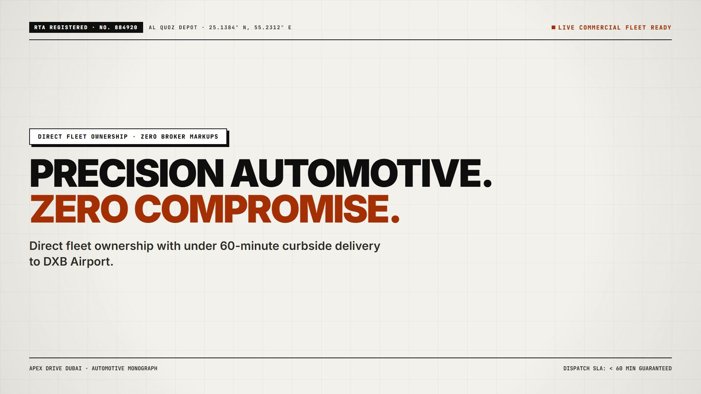
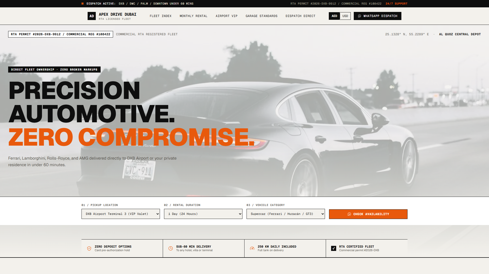
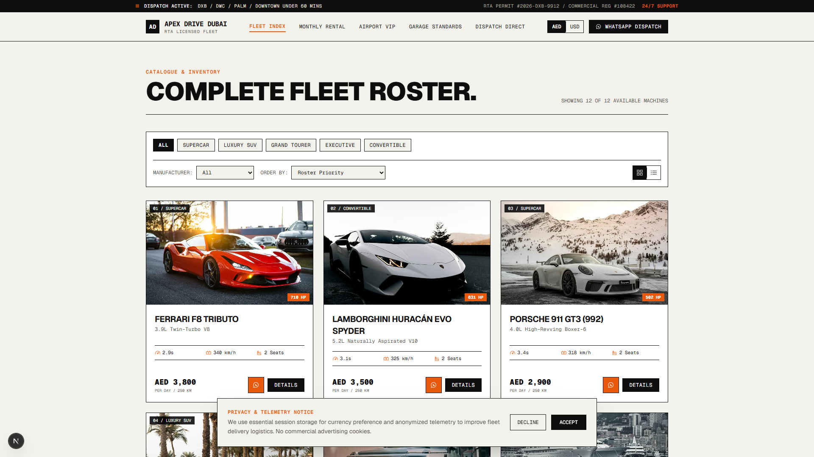
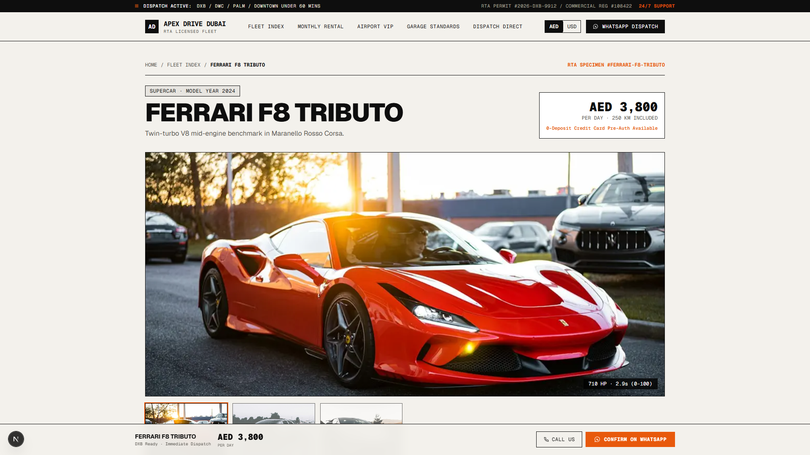
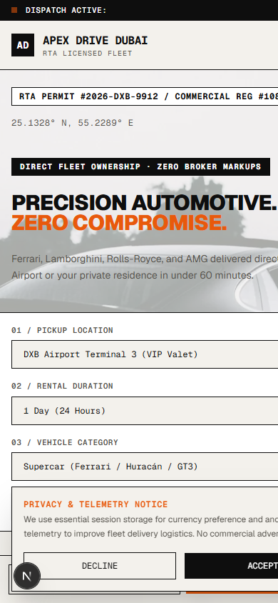
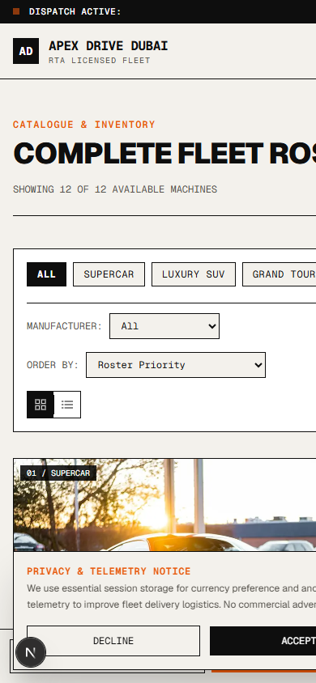

# APEX DRIVE DUBAI · PERFORMANCE & LUXURY CAR RENTAL

> **High-converting, automotive editorial static Next.js master website template for UAE & GCC luxury car rental companies.**

---

## Launch Showcase Video

<video src="brag-output/brag.mp4" poster="brag-output/brag.jpg" controls="controls" width="100%">
  <a href="brag-output/brag.mp4">
    
  </a>
</video>

> 🎬 **[Watch Full Video (`brag-output/brag.mp4`)](brag-output/brag.mp4)** — 18-second automotive editorial overview with audio, factory telemetry (Ferrari F8 710 HP, 0-100 in 2.9s), direct fleet ownership, and under-60-minute DXB curbside dispatch.

---



---

## Executive Overview

A static master template engineered for luxury and exotic car rental operators in Dubai and across the GCC. Built with a strict **Light Mode Automotive Editorial** aesthetic (warm off-white paper base, deep typographic black, precision technical spec sheets, and Signal Orange accents). Every interaction is designed for rapid client rebrand in under 10 minutes and direct high-ticket conversion via WhatsApp.

- **Stack**: Next.js (App Router) + TypeScript + Tailwind CSS
- **Deployment**: Fully static export (`output: "export"`), zero database, zero CMS, zero backend. Deploys to Vercel, Netlify, or any static host with zero configuration.
- **Performance**: Mobile Lighthouse 95+, LCP under 2.0s, CLS under 0.05.
- **Conversion**: WhatsApp-first dispatch flow. Instant booking strip on the hero, sticky action bars on vehicle detail pages, and direct curbside handover coordination.
- **Punctuation & Copy Standard**: Zero em dashes, zero AI buzzwords (*Elevate*, *Unlock*, *Discover*, *Seamless*, *Curated*, *Unparalleled*, *Journey* are strictly banned).

---

## Responsive Viewport Verification

Tested and audited across five standard viewport breakpoints with zero horizontal scroll and fluid typography:

| Viewport | Device Profile | Visual Preview |
|---|---|---|
| **1920 x 1080** | Ultra-Wide Desktop | `screenshots/home-desktop-1920.png` |
| **1280 x 900** | Standard Laptop | `screenshots/home-laptop-1280.png` |
| **768 x 1024** | Tablet (iPad Portrait) | `screenshots/home-tablet-768.png` |
| **390 x 844** | Modern Mobile (iPhone 14/15) | `screenshots/home-mobile-390.png` |
| **360 x 780** | Compact Mobile (Android Standard) | `screenshots/home-mobile-360.png` |

### Key Screen Previews

#### Complete Fleet Catalogue & Interactive Filters


#### Vehicle Detail & Factory Technical Spec Sheet (Ferrari F8 Tributo)


#### Mobile Experience (390px)
<p align="center">
  
  &nbsp;&nbsp;&nbsp;&nbsp;
  
</p>

---

## Design System & Core Features

- **Automotive Editorial Palette**:
  - Warm Paper Base: `#F3F1EC`
  - High-Contrast Panels: `#FFFFFF`
  - Typographic Ink: `#0E0E0E`
  - Signal Orange Accent: `#E8590C` (Hover: `#C94A06`)
  - Subtle Hairlines: `#0E0E0E` / `#D6D2C8`
- **Typography**: Heavy neo-grotesk display (`Geist Sans`) paired with monospace technical tabular figures (`Geist Mono`) for engine specs, lap metrics, and pricing.
- **12 Seeded Vehicles with Complete Specs**:
  - Supercars: Ferrari F8 Tributo, Lamborghini Huracan Evo Spyder, Porsche 911 GT3 (992), BMW M4 Competition, Audi RS6 Avant, Corvette C8 Stingray
  - Luxury SUVs: Rolls-Royce Cullinan, Mercedes-AMG G63, Range Rover Autobiography LWB
  - Grand Tourers & Executive: Bentley Continental GT V8, Mercedes-Maybach S580, Tesla Model S Plaid (1,020 HP)
- **Technical Comparison Matrix**: Hard-ruled comparison table illustrating direct fleet ownership vs typical broker aggregators.
- **Currency Engine**: One-click toggle between AED and USD (fixed peg 3.6725) across all day/week/month pricing tiers.
- **Airport VIP Protocols**: Detailed terminal handover instructions for DXB Terminals 1, 2, 3 and DWC VIP terminal.
- **Monthly Lease Program**: Dedicated long-term corporate terms with savings calculators and maintenance guarantees.

---

## Codebase Architecture

```
dubai-car-rental/
├── public/
│   ├── icon.svg                      # Custom vector speedometer dial emblem
│   └── images/
│       ├── hero/car-hero.webp        # Full-bleed automotive action banner
│       ├── og-share.webp             # 1200x630 branded OpenGraph preview
│       └── fleet/                    # 12 optimized WebP vehicle assets (<150 KB each)
├── src/
│   ├── app/
│   │   ├── globals.css               # Brutalist styling, CSS variables, marquee
│   │   ├── layout.tsx                # Metadata, AutoRental JSON-LD schema, fonts
│   │   ├── page.tsx                  # Master homepage composition
│   │   ├── fleet/page.tsx            # Filterable catalogue (category, brand, sort)
│   │   ├── fleet/[slug]/             # Vehicle spec sheet monograph (SSG)
│   │   ├── monthly-rental/page.tsx   # Corporate & individual long-term leasing
│   │   ├── airport-delivery/page.tsx # DXB/DWC curbside meet & greet protocols
│   │   ├── about/page.tsx            # Mechanical standards, garage philosophy, RTA
│   │   ├── contact/page.tsx          # 4-field instant quote / dispatch booking
│   │   └── legal/page.tsx            # RTA conditions, deposit return, Salik rules
│   ├── components/
│   │   ├── Header.tsx                # Sticky bar, live status ticker, currency toggle
│   │   ├── Footer.tsx                # Roster marquee, hubs list, legal links
│   │   ├── HeroSection.tsx           # Full-bleed visual with quick booking strip
│   │   ├── FeaturedFleetIndex.tsx    # Technical index with cursor-following preview
│   │   ├── CategoryTiles.tsx         # Discipline tiles with oversized numerals
│   │   ├── WhyUsTable.tsx            # Technical comparison table
│   │   ├── HowToRentTable.tsx        # 4-step dispatch protocol table
│   │   ├── DeliveryAreasList.tsx     # Dispatch radius cards with arrival SLAs
│   │   ├── MonthlyBlock.tsx          # Long-term lease savings matrix
│   │   ├── FAQAccordion.tsx          # Accessible UAE rental questions
│   │   ├── FinalCtaBand.tsx          # High-impact dispatch conversion strip
│   │   ├── MobileConciergeBar.tsx    # Sticky mobile action strip
│   │   └── Icons.tsx                 # Custom inline SVGs with 1.5px stroke
│   ├── config/
│   │   └── brand.ts                  # Centralized client branding & contacts
│   ├── context/
│   │   └── CurrencyContext.tsx       # AED / USD state provider
│   └── data/
│       ├── fleet.ts                  # 12 vehicles with full technical spec sheets
│       ├── locations.ts              # 4 dispatch depots & delivery zones
│       ├── faqs.ts                   # 8 official rental condition FAQs
│       └── testimonials.ts           # Verified international client reviews
├── REBRAND.md                        # Step-by-step 10-minute client rebrand guide
└── ASSETS.md                         # Complete asset & image license registry
```

---

## 10-Minute Rebrand Guide

1. Open `src/config/brand.ts` and update the company name, RTA commercial permit number, phone, WhatsApp digits, office address, and coordinates.
2. Open `src/app/globals.css` to update the palette if desired (e.g. switch `#E8590C` to Racing Green `#1B4D3E` or Deep Red `#D9230F`).
3. Update `src/data/fleet.ts` with your specific vehicle availability and AED rates.
4. Run `node scripts/generate-og-image.mjs` to auto-generate a fresh branded 1200x630 link share graphic.

For complete rebrand details, read [`REBRAND.md`](REBRAND.md).

---

## Development & Static Build

### Prerequisites
Node.js 18+ or 20+

### Install Dependencies
```bash
npm install
```

### Run Development Server
```bash
npm run dev
```
Open [http://localhost:3000](http://localhost:3000) or [http://localhost:3001](http://localhost:3001) in your browser.

### Build Production Static Export
```bash
npm run build
```
Generates 100% pre-rendered static HTML and assets in the `/out` directory.

---

## Deployment to Vercel

1. Import this repository into Vercel via GitHub.
2. Framework Preset: **Next.js**
3. Build Command: `npm run build`
4. Output Directory: `out` (or default Vercel output)
5. Zero configuration or backend required.

---

## License

MIT License. Designed and crafted for professional commercial rebrand and deployment.
